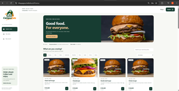
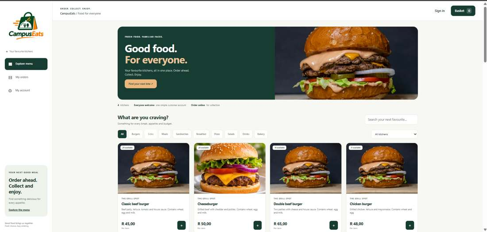
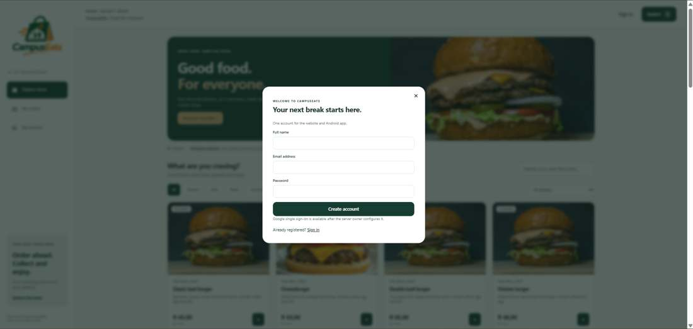
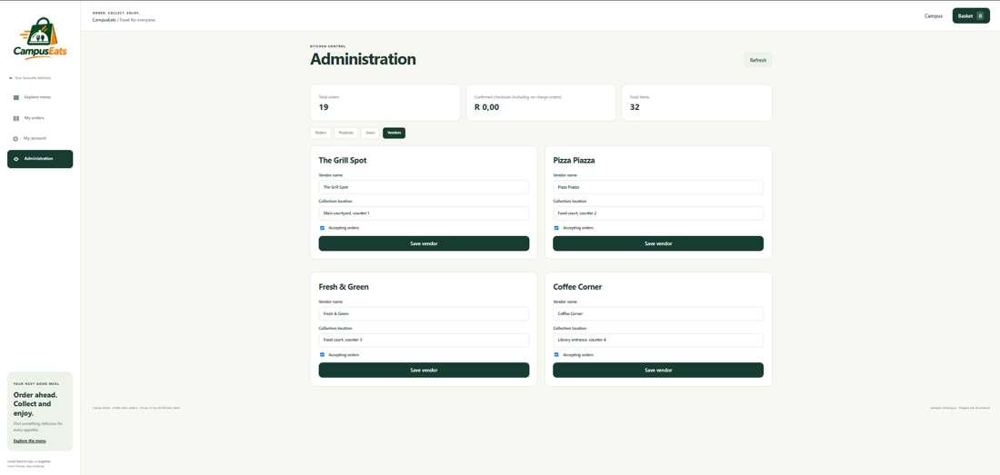
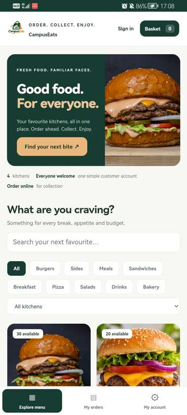
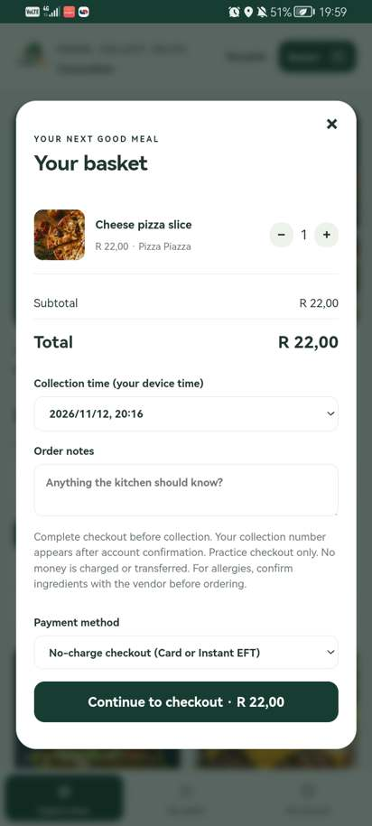
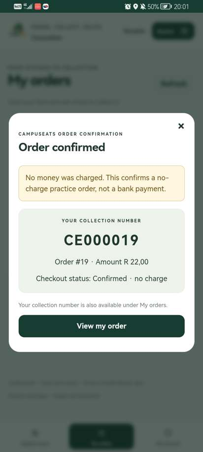

  

<h1 align="center">CampusEats</h1>

<strong>Good food. For everyone.</strong> One food-ordering experience for the web and Android.

  <a href="https://khayaguzu.helioho.st/">Live Website</a> •
  <a href="https://github.com/Khayaguzu/campuseats/actions">GitHub Actions</a> •
  <a href="RELEASE_NOTES.md">Release Notes</a> •
  <a href="#screenshots">Screenshots</a>

> **Version information, 12 November 2026:** This README documents the **current, deployed CampusEats experience (Android v1.1.0)**. Its corresponding updated source is on the [\`codex/google-sso-web-android\` branch](https://github.com/Khayaguzu/campuseats/tree/codex/google-sso-web-android). The repository's default \`main\` source still includes some **older prototype files** until those changes are merged. Do not use an old APK or old database schema as evidence of the updated release.

> **Payment safety:** CampusEats currently demonstrates **no-charge practice checkout**. The card and Instant EFT fields use fictitious sample values. **No actual funds are collected or transferred.** Real PayFast processing is disabled until configured and independently tested. Google sign-in is also unavailable until OAuth credentials are configured.

## Contents

1. [Purpose and problem statement](#1-purpose-and-problem-statement)
2. [Target users and functional scope](#2-target-users-and-functional-scope)
3. [Screenshots](#3-screenshots)
4. [System design and architecture](#4-system-design-and-architecture)
5. [Design considerations](#5-design-considerations)
6. [Technology stack and project structure](#6-technology-stack-and-project-structure)
7. [How to use CampusEats](#7-how-to-use-campuseats)
8. [Local development and Android build](#8-local-development-and-android-build)
9. [GitHub and version-control workflow](#9-github-and-version-control-workflow)
10. [GitHub Actions and automated testing](#10-github-actions-and-automated-testing)
11. [Deployment, configuration and data safety](#11-deployment-configuration-and-data-safety)
12. [Innovations and improvements since the prototype](#12-innovations-and-improvements-since-the-prototype)
13. [Testing evidence, limitations and next steps](#13-testing-evidence-limitations-and-next-steps)
14. [Documentation and release notes](#14-documentation-and-release-notes)

## 1. Purpose and problem statement

### What is CampusEats?

**CampusEats** is an integrated food-ordering website and Android application. Customers can explore meals from different kitchens, review product descriptions and prices, place collection orders, and view progress using a unique collection number. Authorised administrators maintain menu items, vendors, stock and order preparation.

### Problem being addressed

A customer visiting several food counters may need to search for available items manually, check prices at each counter and wait while an order is prepared. Manual ordering can also make it difficult for the customer to know when to collect an item and for a kitchen to keep an organised record of orders. CampusEats provides one digital ordering interface that consolidates the catalogue, account information, basket, order details and collection status.

### Purpose of each platform

| Platform | Purpose | Value to the user |
| --- | --- | --- |
| **Responsive website** | Accessible from a desktop, tablet or mobile browser without installing software | Convenient menu exploration and online collection ordering |
| **Android application** | Provides a phone application using a Kotlin WebView that securely opens the same hosted interface | Consistent ordering on a personal Android device |
| **Shared PHP API and MariaDB** | Enforce login permissions, calculate prices and store menus, customer profiles and orders centrally | Consistency between the two interfaces and one authoritative data source |
| **Administrator dashboard** | Manage products, kitchens, stock, account information and order progression | Improved operational visibility and control |

### Objectives and expected impact

- Make the menu easier to discover through search, categories, kitchen filters, prices, images and stock labels.
- Allow customers to order ahead, choose a collection time and obtain a trackable order reference.
- Provide the same account and order records through the website and Android app.
- Protect administrator-only actions through server-side authorisation.
- Demonstrate the complete ordering workflow without soliciting or collecting real payment details.
- Reduce the complexity of maintaining two separate frontends by reusing the same hosted interface.

These are **project objectives and intended benefits**, not measured claims about reduced waiting times or commercial sales.

## 2. Target users and functional scope

There are **two active account roles** in the updated application.

| Capability | Customer | Administrator |
| --- | :---: | :---: |
| Create an account using name, email and password | ✅ | Separately provisioned |
| Browse products and search/filter by category or kitchen | ✅ | ✅ |
| Manage own profile, theme and notification preference | ✅ | ✅ |
| Add food to basket and select collection time | ✅ | ✅ |
| Complete no-charge practice checkout and receive collection number | ✅ | ✅ |
| View own orders and their current progress | ✅ | ✅ |
| Manage vendors, product descriptions, prices and stock | ❌ | ✅ |
| Advance or cancel applicable orders | ❌ | ✅ |
| Access administration and account-management controls | ❌ | ✅ |

**The updated public registration has no Student or Lecturer selection, institution-number requirement or new-order student discount.** Legacy database fields may remain solely for historical compatibility. Historical order totals are preserved during migration.

The sample catalogue includes multiple kitchens, food categories, descriptions, illustrative photographs, prices in South African rand and collection locations.

## 3. Screenshots

The photographs below are **actual captures of the CampusEats website and Android application**, supplied during the project testing on 12 November 2026. They are documentation evidence, not generated UI mockups. Screens show sample catalogue items and no-charge transactions.

### Website interface

**Figure 1. Website homepage, branding, category navigation and food catalogue.**

**Figure 2. General customer registration.** A new customer enters a full name, email and password, without choosing an academic account type.

**Figure 3. Vendor management, visible only to an authorised administrator.**

### Android application

The application loads the same hosted catalogue through a Kotlin WebView, with responsive bottom navigation on a phone.

<table>
  <tr>
    <td align="center"><strong>Figure 4. Android home</strong></td>
    <td align="center"><strong>Figure 5. Android basket</strong></td>
    <td align="center"><strong>Figure 6. Order confirmation</strong></td>
  </tr>
  <tr>
    <td align="center"></td>
    <td align="center"></td>
    <td align="center"></td>
  </tr>
</table>

Screenshots are reduced in resolution for repository readability and deliberately exclude passwords and real payment credentials.

## 4. System design and architecture

### Architecture

\`\`\`mermaid
flowchart TD
    C["Desktop / mobile browser"] --> W["Hosted responsive PHP / HTML / CSS / JavaScript UI"]
    A["Android Kotlin WebView"] --> W
    W --> API["Same-origin PHP JSON API"]
    API --> AUTH["Session validation and Customer / Administrator permissions"]
    API --> ORD["Products, baskets, orders and checkout rules"]
    AUTH --> DB[("Hosted MySQL / MariaDB")]
    ORD --> DB
    API --> UI["Order status, collection number and account data"]
    UI --> W
\`\`\`

**Key design decision:** The Android application is **not** a second independent ordering implementation. It loads the shared HTTPS web interface, which calls the same-origin PHP API. The database and PHP application remain on the server. This reduces duplicated logic and helps ensure that a price or role rule is enforced once.

### Data flow for a collection order

1. The customer signs in to a Customer account on the browser or within the Android app.
2. The frontend requests catalogue data from the hosted \`api.php\` endpoint.
3. Products are added to a basket, and quantities are displayed with server-backed prices.
4. The customer chooses a collection time and enters optional notes.
5. The practice checkout shows Card or Instant EFT **sample options** and requires account confirmation.
6. The PHP backend validates the account and order, creates the order record and generates a collection reference.
7. The customer views the reference under **My orders**; the Administrator updates order progress as the kitchen prepares it.

### Database model

The project uses an SQL schema with records for \`users\`, \`vendors\`, \`products\`, \`cart\`, \`orders\`, \`order_items\`, \`order_payments\`, \`mobile_tickets\`, \`audit_log\` and \`rate_limits\`. The relationship is based on account and product identifiers, and order lines preserve a snapshot of product information.

\`\`\`mermaid
erDiagram
    users ||--o{ orders : places
    users ||--o{ cart : owns
    vendors ||--o{ products : supplies
    products ||--o{ cart : selected
    orders ||--o{ order_items : contains
    products ||--o{ order_items : references
    orders ||--o| order_payments : checkout
    users ||--o{ mobile_tickets : handoff
    users ||--o{ audit_log : administered_by
\`\`\`

Money is stored as **integer cents**, so R45.00 is represented by 4500. The updated migration changes academic account roles to Customer while keeping existing accounts, orders and historical amounts. The source schema and migration are linked in [Section 11](#11-deployment-configuration-and-data-safety).

## 5. Design considerations

| Consideration | Decision and justification |
| --- | --- |
| **Usability** | Use clear labels and a straightforward ordering journey: menu → basket → checkout → collection number → order tracking. |
| **Visual consistency** | Use the same green, orange and white CampusEats identity across website and Android rather than different branding on each platform. |
| **Responsive design** | Desktop screens use a sidebar; narrow screens use a bottom navigation bar, adaptive cards, fluid dialogs and appropriately sized inputs. |
| **Accessibility** | Semantic navigation, labels, understandable buttons, focus indications and readable contrast are part of the UI design. Further accessibility auditing is still valuable. |
| **Maintainability** | Share the HTML/CSS/JavaScript frontend instead of implementing duplicate price calculations and ordering workflows in Kotlin. |
| **Security** | Use HTTPS on the hosted system, hashed passwords, PHP sessions, role checks and private server configuration outside the public web root. A hidden menu item is not a substitute for server-side authorisation. |
| **Data integrity** | Store product prices in cents, validate quantity/stock on the server, preserve order history and avoid destructive migration over an existing database. |
| **Payment integrity** | Clearly identify no-charge practice checkout, use fictitious data and require validated payment-provider callbacks before any future real-money claims. |
| **Reliability** | Include error and retry behaviour, isolated tests and repeatable builds. Android connectivity requires a reachable HTTPS host. |
| **Privacy** | Do not commit database passwords, OAuth client secrets, customer exports or real card data to a public repository. |
| **Scalability** | Centralised API and database simplify consistency, but production scale would require performance, capacity, security and operational testing. |

## 6. Technology stack and project structure

| Layer | Technology |
| --- | --- |
| Frontend | HTML5, CSS3, vanilla JavaScript |
| Website/backend | PHP and a JSON REST-style API |
| Database | MySQL / MariaDB with PDO |
| Android | Kotlin, Android WebView, AndroidX |
| Build | Gradle wrapper, Java 17, Android SDK 35 |
| Hosting | HelioHost Plesk and HTTPS |
| Version control | Git and GitHub |
| CI | GitHub Actions for APK compilation, PHP checkout and SSO/integration checks |

\`\`\`text
campuseats/
├── README.md
├── RELEASE_NOTES.md
├── docs/
│   └── images/                        # Actual screenshots and CampusEats logo
├── .github/workflows/
│   ├── build-android-apk.yml          # Debug APK build
│   ├── test-checkout-php.yml          # Checkout PHP tests
│   └── test-sso.yml                   # PHP, JS, database and session integration
└── CampusEats_Website_Android_App_Separated/
    ├── Website/
    │   ├── web/                       # Public PHP interface, API and assets
    │   ├── server/                    # Private PHP logic and configuration template
    │   ├── database/                  # Schema and migrations
    │   ├── tests/                     # Automated tests
    │   └── docs/                      # Deployment, API and SSO details
    └── Android_App/
        ├── app/src/main/              # Kotlin Android application
        ├── gradle.properties          # Hosted URL for WebView
        └── gradlew / gradlew.bat
\`\`\`

The active implementation is in the [general-customer source branch](https://github.com/Khayaguzu/campuseats/tree/codex/google-sso-web-android). Version 1.1.0 is configured in its \`Android_App/app/build.gradle.kts\`. The older default branch may not yet contain all those source changes.

## 7. How to use CampusEats

### Customer

1. Open [the website](https://khayaguzu.helioho.st/) or install the Android test APK.
2. Choose **Sign in**, or **Create an account** with a full name, email and password.
3. Open **Explore menu**; search, filter and select food.
4. Open **Basket**, verify quantities and choose a collection time.
5. Continue to the clearly labelled no-charge checkout. Select a sample Card or Instant EFT option, and **never enter real payment details**.
6. Complete the account-confirmation step.
7. Record the generated \`CE...\` collection number.
8. Open **My orders** and refresh to see progress through **Placed → Preparing → Ready → Collected**.

### Administrator

A separately provisioned Administrator sees the **Administration** section. Its tabs support **Orders, Products, Users and Vendors**. The Administrator can update menu products and availability, maintain collection locations, and progress valid orders through their fulfilment stages. Normal Customers cannot access these functions.

## 8. Local development and Android build

### Requirements

- Android Studio with JDK 17 and a compatible Android SDK.
- PHP with PDO MySQL and a local MySQL/MariaDB instance for optional website development.
- WampServer on Windows if local PHP hosting is required.
- Internet access for testing against HelioHost.

### Clone the source

\`\`\`powershell
git clone https://github.com/Khayaguzu/campuseats.git
cd campuseats
git switch codex/google-sso-web-android
\`\`\`

### Run the Android app

1. Open **only** \`CampusEats_Website_Android_App_Separated/Android_App\` in Android Studio.
2. Check its \`gradle.properties\` values:

   \`\`\`properties
   CAMPUS_BASE_URL=https://khayaguzu.helioho.st/
   CAMPUS_SSO_URL=https://khayaguzu.helioho.st/
   \`\`\`

3. Synchronise Gradle, select an emulator or Android phone and press **Run**.
4. Or build a debug APK:

   \`\`\`powershell
   cd CampusEats_Website_Android_App_Separated/Android_App
   .\gradlew.bat :app:assembleDebug
   \`\`\`

5. Find the APK at \`app/build/outputs/apk/debug/app-debug.apk\`.

**Note:** \`10.0.2.2\` is an Android emulator address for a developer's local machine. It is not the URL for a physical phone. For shared/phone builds, use the actual hosted HTTPS address. An APK created before a configuration change must be rebuilt and reinstalled.

### Run the website locally

For a **new local database only**, use the schema and seed SQL provided by the source branch. Copy \`Website/server/config.example.php\` to the private \`config.php\` and set your local database credentials. Do not place this file in Git or inside a publicly served directory.

For an **existing** database with orders and accounts, back up the database and follow the migration guide instead of running a fresh seed import.

See [Website setup](https://github.com/Khayaguzu/campuseats/blob/codex/google-sso-web-android/CampusEats_Website_Android_App_Separated/Website/README.md) and [Android setup](https://github.com/Khayaguzu/campuseats/blob/codex/google-sso-web-android/CampusEats_Website_Android_App_Separated/Android_App/README.md).

## 9. GitHub and version-control workflow

GitHub is the project's **source-control, collaboration, documentation and continuous-integration platform**. It is distinct from the HelioHost server, which actually runs the PHP website.

**How GitHub was used:**

- **Repository:** \`Khayaguzu/campuseats\` stores the website, Android app, SQL migrations, tests and documentation.
- **Commits:** Track changes to source files and provide a history of the prototype and later improvements.
- **Branches:** Separate the main project baseline from the more recent general-customer/SSO update.
- **Pull requests:** Allow changes to be reviewed and tested before they are merged into \`main\`.
- **Workflow files:** Keep build and test steps versioned under \`.github/workflows/\`.
- **Artifacts:** Distribute a generated debug APK for testing without requiring the reviewer to compile it locally.
- **README and release notes:** Provide onboarding, architecture, development steps, visual evidence and a change history.
- **Private configuration:** Actual database passwords and OAuth secrets must **never** be committed.

### Example contribution process

\`\`\`bash
git checkout -b docs/update-project-report
git add README.md RELEASE_NOTES.md docs/images
git commit -m "docs: document CampusEats design, CI and release updates"
git push -u origin docs/update-project-report
\`\`\`

Create a pull request, review the diff and check the relevant workflows before merging. The command above is an **illustration of good workflow**, not a claim that this exact branch was created during development.

## 10. GitHub Actions and automated testing

**GitHub Actions** runs workflows defined in YAML files. It can install build dependencies, compile the Android project, run PHP/JavaScript tests and publish artifacts. This provides repeatable evidence that a commit can build and pass defined checks; it does **not** automatically prove that the live site, phone or real payment provider is working.

### Workflow overview

| Workflow | Trigger and purpose | Main activities | Output |
| --- | --- | --- | --- |
| [Build CampusEats Android APK](.github/workflows/build-android-apk.yml) | Android changes on \`main\`, pull requests in the updated branch, or manual run | Check out repository, install Temurin Java 17 and Android SDK 35, configure Gradle caching, run \`:app:assembleDebug\`, verify APK exists and HTTPS URL is compiled | \`CampusEats-Android-debug-APK\` artifact, retained 30 days |
| [Test CampusEats Checkout PHP](.github/workflows/test-checkout-php.yml) | Checkout-related changes, PR or manual run | Install PHP 8.3, lint payment/API/test PHP, execute payment helper tests | Pass/fail test result in Actions |
| [Test CampusEats SSO](https://github.com/Khayaguzu/campuseats/blob/codex/google-sso-web-android/.github/workflows/test-sso.yml) | Updated branch PR, manual run, or push to \`main\` after merge | Launch isolated MySQL 8 service, lint PHP, check JavaScript syntax, run session/payment tests, migration checks, customer-order integration, shared API contract and SSO ticket/session tests | Pass/fail integration result |

### Successful workflow evidence, 12 November 2026

The following GitHub Actions runs completed **successfully** against the updated feature-branch commit \`abaade98cbc3a5276629fd1a0885e1bbcf35298a\`:

- ✅ [Android APK build, run 43159988806](https://github.com/Khayaguzu/campuseats/actions/runs/43159988806)
- ✅ [Checkout PHP tests, run 43159988817](https://github.com/Khayaguzu/campuseats/actions/runs/43159988817)
- ✅ [SSO and customer integration tests, run 43159988788](https://github.com/Khayaguzu/campuseats/actions/runs/43159988788)

### How to download the generated APK

1. Open [GitHub Actions](https://github.com/Khayaguzu/campuseats/actions).
2. Choose a successful **Build CampusEats Android APK** run for the **updated source branch**, not an older prototype run.
3. Open **Artifacts** and download \`CampusEats-Android-debug-APK\`.
4. Extract the ZIP and install \`app-debug.apk\` on an Android test phone.
5. Confirm the app points to \`https://khayaguzu.helioho.st/\`.

Artifacts expire after the configured retention period. A debug APK is suitable for testing/coursework, **not** a signed Google Play release.

\`\`\`mermaid
flowchart LR
    COMMIT["Git commit / pull request"] --> ACTION["GitHub Actions"]
    ACTION --> BUILD["Android APK build"]
    ACTION --> PHP["PHP checkout tests"]
    ACTION --> SSO["Customer / SSO integration"]
    BUILD --> ARTIFACT["Debug APK artifact"]
    ARTIFACT --> PHONE["Android phone testing"]
    PHP --> RESULT["CI feedback"]
    SSO --> RESULT
\`\`\`

## 11. Deployment, configuration and data safety

The hosted deployment separates public website code from private server code:

\`\`\`text
HelioHost home directory/
├── httpdocs/               # Public index.php, api.php, SSO and assets
└── server/                 # Private bootstrap, sessions, payments, config.php
\`\`\`

For the upgraded Customer release:

1. Back up the existing MariaDB database and private configuration first.
2. Apply \`database/general_customers_migration.sql\` to the **existing** database after reviewing it.
3. Preserve existing customer IDs, passwords, baskets, orders and historical prices.
4. Update the public web and private PHP server code together.
5. Keep \`server/config.php\` out of GitHub and out of \`httpdocs\`.
6. Test customer registration, customer permissions, account settings, menu, checkout, order history and administrator controls.
7. Rebuild the Android APK when Kotlin or Gradle settings change.

Useful documents in the updated branch:

- [General customer migration](https://github.com/Khayaguzu/campuseats/blob/codex/google-sso-web-android/CampusEats_Website_Android_App_Separated/Website/docs/GENERAL-CUSTOMERS.md)
- [HelioHost deployment and rollback](https://github.com/Khayaguzu/campuseats/blob/codex/google-sso-web-android/CampusEats_Website_Android_App_Separated/Website/docs/HELIOHOST-DEPLOYMENT.md)
- [API documentation](https://github.com/Khayaguzu/campuseats/blob/codex/google-sso-web-android/CampusEats_Website_Android_App_Separated/Website/docs/API.md)
- [SSO configuration guide](https://github.com/Khayaguzu/campuseats/blob/codex/google-sso-web-android/CampusEats_Website_Android_App_Separated/Website/docs/SSO-DEMONSTRATION.md)

## 12. Innovations and improvements since the prototype

This release is an **incremental improvement of an existing working prototype**, not a claim that every feature is new to computing. The following changes differentiate the updated project from its earlier CampusEats version:

| Area | Earlier prototype | Updated CampusEats v1.1.0 | Contribution |
| --- | --- | --- | --- |
| **Audience** | Student/Lecturer-oriented registration | General public Customer registration; separate Administrator | More inclusive onboarding and simpler role rules |
| **Branding** | Earlier institution-related design | Consistent independent CampusEats logo, colours and food-led UI | Stronger, coherent product identity |
| **Android experience** | Local server / emulator URL could prevent connectivity | Shared hosted HTTPS interface with responsive styling and physical-device testing | Same experience across browser and phone |
| **Identity and permissions** | Academic account verification and role requests | Customer-only public signup, server-enforced Administrator permissions | Reduced privilege-escalation risk |
| **Shared information** | Existing website/app integration | Verified current shared accounts, order records and profile settings | One central source of truth |
| **Checkout** | Earlier checkout controls | Explicit sample Card / Instant EFT no-charge workflow and confirmation reference | End-to-end demonstration without financial transactions |
| **Order tracking** | Basic collection workflow | Clear order stage, collection number and order-history views | Better visibility of progress |
| **Preferences** | Earlier account configuration | Mobile-friendly profile, theme and order-update preferences | Personalised UI and account management |
| **Quality assurance** | Primarily manual prototype testing | GitHub Actions APK compilation, PHP checkout checks, SSO/customer integration tests | Repeatable build and regression evidence |
| **Deployment** | Local-development assumptions | HelioHost private/public file separation and migration/rollback guidance | More reliable deployment practice |

**Innovative features in the context of this coursework:**

1. **Shared web-and-app architecture:** A Kotlin WebView reuses the hosted responsive interface and server-side rules.
2. **Controlled account migration:** Historical orders remain while prior academic roles are converted to general Customers.
3. **Server-authoritative ordering:** Stock, totals, permissions and order states are validated by the PHP backend.
4. **Practice payment experience:** Checkout supports realistic Card/Instant EFT selection and collection confirmation without charging customers.
5. **Cross-platform order visibility:** Browser and phone display the same persisted order records once each client is authenticated.
6. **Automated build/test pipeline:** GitHub Actions provides reproducible verification and testable Android APK artifacts.

For the complete detailed change log and evidence, read [RELEASE_NOTES.md](RELEASE_NOTES.md).

## 13. Testing evidence, limitations and next steps

### Testing recorded for this project

- The live website loaded its updated menu, logo, category filters and food images.
- Android Studio produced a successful APK build and the app opened against the hosted HTTPS address.
- Android's responsive CSS issue was corrected and verified visually in the emulator.
- Customer login and My orders were exercised through Android.
- A no-charge practice checkout produced a collection number (for example, \`CE000016\` and \`CE000019\`); corresponding order details were visible under My orders.
- Customer access and administrator-only navigation were checked during testing.
- Three GitHub Actions workflows passed for the updated source commit, as linked above.

### Known limitations

- **No actual payment processing.** No-charge checkout must not be described as payment received. Real provider integration requires additional validation and merchant setup.
- **Google Sign-In not configured.** Source support exists but production OAuth keys, consent-screen configuration and redirect validation are still required.
- **Debug APK only.** Publishing to Google Play requires a separately signed Android App Bundle and further release testing.
- **Internet dependence.** The Android WebView requires the hosted site and API to be reachable.
- **Sample content.** Product photographs and catalogue entries are illustrative.
- **Unmerged source branch.** The v1.1.0 Customer implementation is on \`codex/google-sso-web-android\` until reviewed and merged to \`main\`.
- **Accessibility and load testing.** More systematic accessibility, performance, device compatibility and security testing are appropriate before production use.

### Future improvements

- Configure and test Google OAuth sign-in in a controlled environment.
- Integrate a genuine payment provider with verified server-side callbacks before enabling real charges.
- Complete release signing, Play Store assets, device testing and store policy checks.
- Add wider integration, usability, accessibility and performance test coverage.
- Improve customer notifications and production monitoring when justified by requirements.

## 14. Documentation and release notes

| Document | Purpose |
| --- | --- |
| **[RELEASE_NOTES.md](RELEASE_NOTES.md)** | Prototype-to-v1.1.0 update history and specifically identified innovative features |
| [General Customers](https://github.com/Khayaguzu/campuseats/blob/codex/google-sso-web-android/CampusEats_Website_Android_App_Separated/Website/docs/GENERAL-CUSTOMERS.md) | Migration and updated role model |
| [HelioHost Deployment](https://github.com/Khayaguzu/campuseats/blob/codex/google-sso-web-android/CampusEats_Website_Android_App_Separated/Website/docs/HELIOHOST-DEPLOYMENT.md) | Backups, deployment sequence, tests and rollback |
| [Website README](https://github.com/Khayaguzu/campuseats/blob/codex/google-sso-web-android/CampusEats_Website_Android_App_Separated/Website/README.md) | Local website setup |
| [Android README](https://github.com/Khayaguzu/campuseats/blob/codex/google-sso-web-android/CampusEats_Website_Android_App_Separated/Android_App/README.md) | Device configuration and APK creation |

**Project team:** Makaya Guzu and Naoyuki Christopher Higaki.  
**Project type:** Academic software-development portfolio.  
**Last documentation update:** 12 November 2026.
