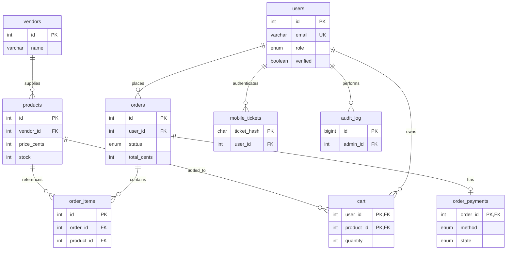

# CampusEats | Campus food ordering website and Android app

**CampusEats** is a coursework project for browsing campus food, placing collection orders and managing kitchen operations. It consists of a responsive **PHP website**, a **Kotlin Android application**, a **shared PHP REST API** and a **MySQL/MariaDB database**.

**Hosted website:** https://khayaguzu.helioho.st/  
**Source:** https://github.com/Khayaguzu/campuseats  
**Platform:** Browser (desktop/mobile) and Android 8.0+ (API 26+)  
**Intended use:** Education, demonstration and development. Catalogue, vendors, photographs and transactions are illustrative.

> **Important:** The Android app uses a WebView to display the **same** responsive website. It does not connect directly to MySQL or implement a second ordering system. The website and Android app share server-side accounts, food, stock, baskets, orders and settings. Each client signs in separately because its session cookies are separate.

## Contents

1. [Features and user roles](#1-features-and-user-roles)
2. [Getting started as a customer](#2-getting-started-as-a-customer)
3. [Ordering and checkout](#3-ordering-and-checkout)
4. [Administrator guide](#4-administrator-guide)
5. [System architecture and folder layout](#5-system-architecture-and-folder-layout) ([database structure](#database-structure-and-relationships))
6. [Run the website locally with WampServer](#6-run-the-website-locally-with-wampserver)
7. [Run or build the Android app](#7-run-or-build-the-android-app)
8. [Download an APK from GitHub Actions](#8-download-an-apk-from-github-actions)
9. [Deploy the website to HelioHost/Plesk](#9-deploy-the-website-to-heliohostplesk)
10. [Configure coursework checkout](#10-configure-coursework-checkout)
11. [Optional Google sign-in and genuine payments](#11-optional-google-sign-in-and-genuine-payments)
12. [Testing and troubleshooting](#12-testing-and-troubleshooting)
13. [Development summary and further documentation](#13-development-summary-and-further-documentation)

## 1. Features and user roles

| Feature | Student | Lecturer | Administrator |
| --- | --- | --- | --- |
| Browse food, search and filter by category/vendor | Yes | Yes | Yes |
| Register, sign in and manage personal information | Yes | Yes | Yes |
| Save a basket and place collection orders | Yes | Yes | Yes |
| Track order status and collection number | Yes | Yes | Yes |
| Change password, appearance and notification preferences | Yes | Yes | Yes |
| Receive a **10% student discount** | **After student-number verification** | No | No |
| Manage food items, quantities, prices and vendors | No | No | Yes |
| Verify student numbers and approve administrator requests | No | No | Yes |
| Mark orders as preparing, ready and collected | No | No | Yes |

**Catalogue:** Four sample kitchens are included: **The Grill Spot**, **Pizza Piazza**, **Fresh & Green** and **Coffee Corner**, with **32 sample products**. Products have descriptions, illustrative photos, quantities, prices in South African rand and collection locations.

Administrator access is controlled on the server. Selecting **Administrator** during registration **requests approval**; it does not immediately grant administrator privileges. A verified student receives the student discount; an unverified student can still order, but without the discount. Lecturers do not require student verification for ordinary ordering.

### Main pages

- **Explore menu:** View products, filter by category or kitchen, search, and add food.
- **My orders:** View order history, amounts, collection numbers and progress: **Placed → Preparing → Ready → Collected**.
- **My account:** Update name, contact details, theme, order-update preference and password; view or request a campus role.
- **Administration:** Manage orders, products, user verification and vendors. Only available to approved administrators.
- **Basket/checkout:** Change item quantities, see the applicable student discount, choose collection time, enter order notes and confirm an order.

## 2. Getting started as a customer

1. Open **https://khayaguzu.helioho.st/** in a browser or launch the installed CampusEats Android app.
2. Select **Sign in → Create an account** if new. Provide a name, email, password and account type (**Student** or **Lecturer**). Students also provide a student number.
3. If already registered, select **Sign in** and use your CampusEats email/password.
4. Open **Explore menu**, choose food items and select the **+** button to add them.
5. Open **Basket** to check quantities and totals.
6. To change details later, go to **My account** and select **Save changes**.

**Student verification:** An administrator checks the student number and approves verification under **Administration → Users**. Until then, the 10% discount is not applied.

**Lecturers:** Choose **Lecturer** during registration. The ordering process is the same as for students, but no student discount is applied.

**Administrator:** The first administrator is created through the CLI setup script on a new local installation. Later administrator registrations must be approved by an existing authorised administrator.

## 3. Ordering and checkout

1. Sign in and add food to the basket. Products display prices and available quantities.
2. Review the basket. A verified student receives **10% off**; other users pay the full displayed amount.
3. Choose a collection time and optionally enter notes about the order. Confirm any allergies directly with the vendor.
4. Select **Continue to checkout** if the configured checkout method is available.
5. For the **coursework/no-charge** checkout, choose **Card** or **Instant EFT** as an on-screen option; **do not enter real card or bank credentials**. Re-enter your **CampusEats email and password** to confirm the account.
6. After the server confirms the order, note the **collection number**, which is also available under **My orders**.
7. Follow its status in the website or Android app. An administrator marks an order **Preparing**, then **Ready**, then **Collected**.

**Example:** A verified student orders a R45 burger and R50 cheeseburger. Subtotal **R95.00** − student discount **R9.50** = **R85.50**. The server calculates the final totals rather than trusting browser-submitted prices.

**No-charge checkout is a school-project simulation.** No money or real payment is processed by this mode; a simulated confirmation is not proof of payment. The display may use a payment-style flow for demonstrating account verification, order confirmation and collection numbers. It must not be used to solicit money. Real PayFast payment is a separate, optional integration that requires properly configured merchant credentials and independent validation.

**Account and order state:** Website and Android sessions are independent, but records are centrally stored. Sign in with the same account on each device and refresh **My orders** to see server-side changes.

## 4. Administrator guide

After signing in as an approved administrator, select **Administration** in the navigation. Four tabs are available:

| Tab | What the administrator can do |
| --- | --- |
| **Orders** | Review orders and collection details; progress valid paid/confirmed orders from placed through preparing, ready and collected. |
| **Products** | Add or edit food names, descriptions/allergens, kitchens, categories, selling prices, stock, images and menu visibility. |
| **Users** | See account types, verify student numbers and approve authorised role requests. |
| **Vendors** | Update the kitchen name, collection counter/location and whether it is accepting orders. |

To add food, go to **Administration → Products → Add food item**, enter all required details and save. Food pictures are server-managed files under `web/assets/food/`; select an existing `.jpg` image name. This version does not provide an unrestricted public image-upload endpoint.

To fulfil an order, open **Administration → Orders**, identify the collection number and use the status button in order: **Mark preparing → Mark ready → Confirm collection**. An order cannot skip the required workflow. Do not hand over food solely because a screenshot shows a collection number; verify the record and current status in the administration panel.

Keep administrator accounts private. Verify a requested administrator's authorisation before approving. Verify student numbers against appropriate campus records before applying discounts.

## 5. System architecture and folder layout

```text
Browser / Android (Kotlin WebView)
              |
              v
    PHP website (web/index.php)
     JavaScript (web/assets/app.js)
              |
     Same-origin JSON requests
              v
       PHP API (web/api.php)
              |
   Server-side auth, orders, stock
   server/bootstrap.php + payments.php
              |
              v
         MySQL / MariaDB
```

```text
campuseats/
├── README.md                          <-- This guide
├── .gitignore
├── .github/workflows/
│   ├── build-android-apk.yml
│   └── test-checkout-php.yml
└── CampusEats_Website_Android_App_Separated/
    ├── Website/
    │   ├── web/
    │   │   ├── index.php
    │   │   ├── api.php
    │   │   ├── sso.php
    │   │   ├── pay.php
    │   │   ├── payfast-itn.php
    │   │   └── assets/ (app.js, style.css, logo, food photos)
    │   ├── server/
    │   │   ├── bootstrap.php
    │   │   ├── payments.php
    │   │   ├── config.example.php
    │   │   └── create-admin.php
    │   ├── database/
    │   │   ├── schema.sql
    │   │   ├── seed.sql
    │   │   └── payment_migration.sql
    │   ├── tests/
    │   └── docs/
    └── Android_App/
        ├── app/src/main/java/za/ac/campuseats/MainActivity.kt
        ├── gradle.properties
        ├── gradlew / gradlew.bat
        └── app/build.gradle.kts
```

**Security boundary:** `server/config.php` is private, excluded from Git and never copied to the Android app. Only the **contents of `Website/web/`** belong in a public document root; the `server/` directory belongs **outside** that public root. PHP and the database run on the server, not on the phone.

The website uses PHP, HTML, CSS and vanilla JavaScript. The app is written in Kotlin and wraps the shared interface in WebView. It uses Gradle 8.9, Android Gradle Plugin 8.7.3, Kotlin 2.0.21, JDK 17 and Android SDK 35.

### Database structure and relationships

CampusEats uses a relational **MySQL/MariaDB database** with **10 tables**. The definitive table definitions are maintained in [database/schema.sql](CampusEats_Website_Android_App_Separated/Website/database/schema.sql); [database/payment_migration.sql](CampusEats_Website_Android_App_Separated/Website/database/payment_migration.sql) creates or updates the payment table for existing installations. The tables below describe the **repository's schema**; a separately maintained hosted database should be checked for any later migrations.

**Entity-relationship diagram (ERD)** — relationship lines follow the foreign keys in the SQL schema:



**Table-by-table data dictionary** (column names correspond to the SQL files):

| Table | Primary key | Other columns | Foreign keys and purpose |
| --- | --- | --- | --- |
| **users** | `id` (`INT UNSIGNED`) | `name`, `email`, `password_hash`, `google_sub`, `role`, `requested_role`, `student_number`, `verified`, `phone`, `theme`, `order_updates`, `created_at` | Accounts for students, lecturers and admins; `email` and non-null `google_sub` are unique. Passwords are stored as hashes, not plaintext. |
| **vendors** | `id` (`INT UNSIGNED`) | `name`, `location`, `is_open` | Food kitchens, their collection counters and order availability. |
| **products** | `id` (`INT UNSIGNED`) | `vendor_id`, `name`, `description`, `category`, `price_cents`, `stock`, `image`, `active` | `vendor_id → vendors.id`. Each food item belongs to a kitchen. |
| **orders** | `id` (`INT UNSIGNED`) | `user_id`, `status`, `subtotal_cents`, `discount_cents`, `total_cents`, `pickup_at`, `notes`, `payment_status`, `request_key`, `created_at` | `user_id → users.id`. One user can have many orders; `(user_id, request_key)` is unique to protect against duplicate submissions. |
| **order_items** | `id` (`INT UNSIGNED`) | `order_id`, `product_id`, `name`, `vendor_name`, `location`, `quantity`, `price_cents` | `order_id → orders.id`, `product_id → products.id`. Stores each ordered item together with a snapshot of the product name, vendor, location and price. |
| **cart** | Composite: `(user_id, product_id)` | `quantity` | `user_id → users.id`, `product_id → products.id`. A user has at most one cart row per product. |
| **rate_limits** | `id` (`BIGINT UNSIGNED`) | `bucket`, `occurred_at` | Independent security/rate-limiting event records. Indexed on `(bucket, occurred_at)`; no foreign key. |
| **mobile_tickets** | `ticket_hash` (`CHAR(64)`) | `user_id`, `challenge`, `expires_at` | `user_id → users.id`. Short-lived tickets supporting mobile authentication handoff. |
| **audit_log** | `id` (`BIGINT UNSIGNED`) | `admin_id`, `action`, `target_id`, `created_at` | `admin_id → users.id`. Logs actions by administrators; `target_id` is an action-specific ID, not an SQL foreign key. |
| **order_payments** | `order_id` (`INT UNSIGNED`) | `method`, `state`, `bank_reference`, `gateway_payment_id`, `confirmed_at`, `payment_token_hash`, `payment_token_expires_at`, `created_at` | `order_id → orders.id`. Maximum one payment record per order. `gateway_payment_id` is unique when set. |

**Important database rules and types:**

- All 10 tables use **InnoDB**. The schema uses `utf8mb4` for the database, and `INT UNSIGNED` / `BIGINT UNSIGNED` for numeric identifiers.
- Monetary values (`price_cents`, `subtotal_cents`, `discount_cents`, `total_cents`) are stored as **integer cents**, not decimal rand. For example, `4500` represents **R45.00**. `stock` and `quantity` are non-negative unsigned integers.
- `users.role` / `users.requested_role` allow `student`, `lecturer`, `admin`. `users.verified` controls verification; an approved administrator role is distinct from a requested role.
- `orders.status` allows `placed`, `preparing`, `ready`, `collected`, `cancelled`; `orders.payment_status` allows `unpaid`, `paid`.
- `order_payments.method` allows `eft`, `payfast`, `demo`; `order_payments.state` allows `pending`, `paid`. **A `paid` state in the coursework flow represents simulated order confirmation, not money received.**
- `created_at` fields default to the current timestamp. `orders.pickup_at` is a `DATETIME`; the UI displays local South African collection times.
- The ERD shows **defined SQL foreign-key relationships**, not every business-level association. The independent `rate_limits` table is omitted from the relationship diagram because it has no foreign keys.

**How to inspect your database in phpMyAdmin**

1. Open your local `campuseats` database in WampServer phpMyAdmin, or the **Plesk-prefixed database** created for HelioHost.
2. Select **Structure** to see all tables and their columns; use the **Relation view** where available to inspect foreign keys.
3. In the SQL tab, run read-only queries:

   ```sql
   SHOW TABLES;
   SHOW CREATE TABLE users;
   SHOW CREATE TABLE products;
   SHOW CREATE TABLE orders;
   SHOW CREATE TABLE order_payments;
   ```

4. Compare the result with `database/schema.sql`. Do **not** paste private account or password-hash exports into public GitHub issues.

**New installation versus migration:** A fresh database uses `schema.sql` followed by `seed.sql`. An **existing** database containing users and orders should be **backed up** and, only if needed, updated through `payment_migration.sql`. For HelioHost, edit an *import copy* to remove/replace `CREATE DATABASE campuseats` and `USE campuseats` so the SQL targets the actual Plesk-prefixed database. Never run the initial seed twice or replace the hosted database just to update documentation.

## 6. Run the website locally with WampServer

**Requirements:** Windows, WampServer (Apache and MySQL/MariaDB), PHP **7.2+** with PDO MySQL enabled, a browser and phpMyAdmin. The project has legacy PHP 7.2–7.4 compatibility for local use, but **PHP 7.x is no longer security-supported**. Use a currently supported PHP version on a public host.

### Clone into the existing project layout

In Windows PowerShell:

```powershell
cd C:\wamp64\www
git clone https://github.com/Khayaguzu/campuseats.git
cd C:\wamp64\www\campuseats
```

Start WampServer and wait until Apache and the database server are running. If you cloned the repo as shown, the website is at:

**http://localhost/campuseats/CampusEats_Website_Android_App_Separated/Website/web/**

This is a *nested repository* URL. The shorter `http://localhost/campuseats/web/` only applies if you separately copy the **contents** of `Website/` directly into `C:\wamp64\www\campuseats`.

### Set up the database

- **Fresh local installation:** In phpMyAdmin, select the MySQL/MariaDB instance you intend to use, then import `Website/database/schema.sql` and afterwards `Website/database/seed.sql`. Do this only once on a fresh database.
- **Existing installation with data:** **Back it up first**; do not re-import `schema.sql` or `seed.sql`. Apply `Website/database/payment_migration.sql` if the `order_payments` table is missing.
- The database port may be **3306**, **3307** or **3308**, depending on your WampServer configuration. The PHP connection must use the same server/port as the imported database.

Copy `Website/server/config.example.php` to `Website/server/config.php` and edit **only your private copy**, for example:

```php
'db_host' => '127.0.0.1',
'db_port' => 3308, // Replace with YOUR actual MySQL/MariaDB port.
'db_name' => 'campuseats',
'db_user' => 'YOUR_LOCAL_DB_USER',
'db_password' => 'YOUR_PRIVATE_PASSWORD',
'base_url' => 'http://localhost/campuseats/CampusEats_Website_Android_App_Separated/Website/web',
'secure_cookies' => false,
```

Those lines are settings **inside the returned PHP array**, not a complete replacement for the configuration file.

Create the initial admin **only on a fresh installation** by running the PHP CLI script, substituting your PHP executable if `php` is not on `PATH`:

```powershell
cd C:\wamp64\www\campuseats
php .\CampusEats_Website_Android_App_Separated\Website\server\create-admin.php admin@example.com "Campus Administrator" "ChooseYourOwnStrongPassword"
```

Check the API at your local nested URL followed by `api.php?action=bootstrap`. A valid setup returns JSON; then open the website and sign in.

## 7. Run or build the Android app

1. Install **Android Studio**, JDK 17 (or Android Studio's compatible bundled runtime) and the Android SDK.
2. Select **File → Open** and choose **only** `C:\wamp64\www\campuseats\CampusEats_Website_Android_App_Separated\Android_App`.
3. Open `gradle.properties`; for the **hosted website**, set:

   ```properties
   CAMPUS_BASE_URL=https://khayaguzu.helioho.st/
   CAMPUS_SSO_URL=https://khayaguzu.helioho.st/
   ```

4. Click **Sync Project with Gradle Files**, then select an emulator or connected Android phone.
5. Press **Run** in Android Studio, or use PowerShell to build a debug APK:

   ```powershell
   cd C:\wamp64\www\campuseats\CampusEats_Website_Android_App_Separated\Android_App
   .\gradlew.bat clean :app:assembleDebug
   ```

6. Find the local output in `Android_App/app/build/outputs/apk/debug/app-debug.apk`. Install it on your Android phone only if you trust the source.

A **`BUILD SUCCESSFUL`** result means Gradle completed. Deprecation warnings are not build failures. The generated `BuildConfig.java`, `.gradle/`, `.idea/`, `build/`, `app/build/` and `local.properties` are local/generated files: **do not edit or commit them**.

### Local emulator testing

To use WampServer instead of the hosted HTTPS site, temporarily set **both** Gradle URL properties to:

```properties
CAMPUS_BASE_URL=http://10.0.2.2/campuseats/CampusEats_Website_Android_App_Separated/Website/web/
CAMPUS_SSO_URL=http://10.0.2.2/campuseats/CampusEats_Website_Android_App_Separated/Website/web/
```

`10.0.2.2` works **inside the Android emulator only**. It reaches the Windows computer; it is not a URL for Windows Chrome or a physical phone. A physical device can use the hosted HTTPS URL, or a correctly configured private LAN address for local development. Release builds require HTTPS. Restore the hosted URLs before producing an APK for sharing.

## 8. Download an APK from GitHub Actions

GitHub Actions automatically compiles the Android **debug APK** when relevant Android files change on `main`. You can also trigger the workflow manually:

1. Open **[GitHub Actions](https://github.com/Khayaguzu/campuseats/actions)**.
2. Choose **[Build CampusEats Android APK](https://github.com/Khayaguzu/campuseats/actions/workflows/build-android-apk.yml)**.
3. Select **Run workflow → main → Run workflow** (if permitted by your GitHub account).
4. Wait for the **Build debug APK** job to finish successfully.
5. Open the completed workflow run, scroll to **Artifacts**, and download **`CampusEats-Android-debug-APK`**.
6. Extract the ZIP and install its `app-debug.apk` on a test Android device. Installation from outside the Play Store may require device permission.

The workflow builds with Java 17 and SDK 35 and checks that the hosted HTTPS address is included. Artifacts are kept for **30 days**. This is a **debug/test APK**, not a Play Store release; production distribution requires a properly signed release and further testing.

**PHP tests:** The separate [Test CampusEats Checkout PHP](https://github.com/Khayaguzu/campuseats/actions/workflows/test-checkout-php.yml) workflow syntax-checks checkout PHP and runs payment helper tests. Passing CI does not replace manual browser/phone tests.

## 9. Deploy the website to HelioHost/Plesk

The project was deployed for coursework using HelioHost's Plesk File Manager and MariaDB. On any PHP host, preserve this separation:

```text
Home directory/
├── httpdocs/                  <-- public web files ONLY
│   ├── index.php
│   ├── api.php
│   ├── pay.php
│   ├── payfast-itn.php
│   ├── sso.php
│   └── assets/ (including food/)
└── server/                    <-- PRIVATE PHP server files
    ├── bootstrap.php
    ├── payments.php
    └── config.php             <-- PRIVATE, never in Git
```

The PHP files in `httpdocs` use relative includes that expect the private `server` folder to be its sibling. **Do not upload `server/config.php` into `httpdocs` or commit it to GitHub.**

### Hosted setup sequence

1. Create the hosting site and open **Plesk → Files**.
2. Copy **the contents of `Website/web/`** into `httpdocs/`. Uploading a ZIP and extracting it there is convenient. Do not leave the files hidden under an extra `web/` subfolder unless the website URL is adjusted accordingly.
3. Create `server/` **beside**, not inside, `httpdocs/`. Upload `bootstrap.php` and `payments.php` and prepare a private `config.php`.
4. Create a MariaDB database and a dedicated database user in **Plesk → Databases**. Plesk may prefix names, such as `YOURPREFIX_campuseats`; use the actual values in the private PHP config. Database access normally needs **local connections only**.
5. **For a fresh host database**, select that database in phpMyAdmin. The repository's `schema.sql` begins with `CREATE DATABASE campuseats` and `USE campuseats`: remove/adjust those statements in an import copy when using a Plesk-prefixed database. Likewise remove/adjust `USE campuseats` in an import copy of `seed.sql`, and import the seed **once**.
6. **For an existing hosted database**, make a backup and apply only needed migrations. **Do not run the seed again**. The `payment_migration.sql` also contains `USE campuseats`, so adjust an import copy to target the selected Plesk database.
7. Set `base_url` to the real HTTPS website origin, e.g. `https://khayaguzu.helioho.st`, and set `secure_cookies` to `true`.
8. Confirm the main page and `/api.php?action=bootstrap` load from the live domain.

**File permissions:** For ordinary public static assets and PHP files use **644** (`rw-r--r--`); for public asset directories such as `assets/` and `assets/food/` use **755** (`rwxr-xr-x`). If CSS, JavaScript, the logo or food images show **403 Forbidden**, confirm that the directories are traversable and the files readable, then refresh. Keep the private server area restricted appropriately; do not set credentials to public access or use 777 permissions.

**Do not export real user/password tables to GitHub.** The hosted database and local WampServer database are separate until data is explicitly migrated. Existing local usernames do not magically appear on a new host; import only authorised data through secure channels or register accounts on the host.

## 10. Configure coursework checkout

The project includes two **distinct** no-charge testing modes:

| Mode | Where | Purpose |
| --- | --- | --- |
| `payments.demo` | Local loopback only | Developer payment simulation on localhost. Deliberately blocked for remote devices and public hosts. |
| `payments.school_checkout` | Explicitly configured HTTPS host | Coursework order-confirmation flow for signed-in users. Does not move funds. |
| `payments.payfast` | Configured HTTPS callback | Optional genuine provider payment, **disabled unless configured**. |

**Do not interpret `school_checkout` as a real payment gateway.** The UI provides simulated Card/Instant EFT choices for the course demonstration, and stores confirmation/collection status without collecting banking credentials or funds.

For a controlled coursework site, add the following **inside the existing `payments` section** in the **private** `server/config.php`:

```php
'school_checkout' => [
    'enabled' => true,
    'allow_registered_users' => true,
    'allowed_user_ids' => []
],
```

- With `allow_registered_users=true`, any **signed-in account** with a valid user ID (including newly registered students and lecturers) can use the no-charge flow. **Anonymous visitors cannot check out.**
- With `allow_registered_users=false`, only IDs in `allowed_user_ids` can check out. If the list is empty, nobody qualifies.
- Student **verification still determines the 10% discount** and never grants administrator privileges.
- The configured `base_url` must be HTTPS and match the request host. The PHP server must have the current `server/payments.php` and `web/api.php` source.
- The customer confirms the order by supplying **the same CampusEats account email and password**, not bank credentials.
- Set `school_checkout.enabled=false` when no longer demonstrating. **Open registration plus no-charge orders on a public site can be abused**; use the restricted allowlist when appropriate.

**Existing database:** Make sure the `order_payments` table exists. Back up the database before applying the payment migration, adjusting any database-name statement to match your actual host.

### Confirming checkout

Sign in with a **new student or lecturer**, add food to the basket and check whether **Continue to checkout** is shown. Confirm the account credentials and verify a **collection number** appears under **My orders**. The administrator can then move the order through the status stages. Repeat on the Android app: it accesses the **same hosted PHP API and database**.

## 11. Optional Google sign-in and genuine payments

**Google single sign-on (optional):** The PHP backend includes `sso.php` and an Android browser-return flow. Google sign-in is not available until the site owner creates OAuth credentials, registers the correct callback URI and sets `google_client_id` and `google_client_secret` **privately**. Email/password login works without Google SSO. Google identity does not automatically grant verified student or administrator privileges. See [the website's SSO setup instructions](CampusEats_Website_Android_App_Separated/Website/README.md#3-configure-google-single-sign-on).

**PayFast (optional):** A real merchant flow is implemented separately through `pay.php` and `payfast-itn.php`, with server-side provider verification. It must be configured and independently sandbox-tested before any real use. No live merchant credentials are provided and **the coursework mode does not charge money**. Manual EFT approval is not part of the current checkout flow. Never request bank passwords or card numbers in CampusEats itself.

## 12. Testing and troubleshooting

### Project checks

From the **Website** directory in PowerShell:

```powershell
cd C:\wamp64\www\campuseats\CampusEats_Website_Android_App_Separated\Website
python tests\shared_client_contract.py
php tests\payment_helpers.php
php -l web\api.php
php -l server\payments.php
```

The shared-client check verifies source-level website/Android API parity; the payment helper tests check pricing/signatures and restrictions on no-charge checkout. The integration suite (`tests/integration.py`) **writes database records**: run it **only on an isolated test database**, never the hosted course database.

### Common problems

| Symptom | Check / solution |
| --- | --- |
| Blank/unformatted page or missing photos | Check `httpdocs/assets/` and permissions: files **644**, directories **755**. Hard-refresh the page. |
| API says "Server setup required" or "Service unavailable" | Confirm private `server/config.php`, database host/port/name/user, PHP PDO MySQL and server error logs. |
| Login worked locally but not online | Local and hosted databases are different; create/import the correct hosted user record safely. |
| "Email or password is incorrect" | Use the CampusEats password for that **hosted account**; reset/change it through authorised account settings. |
| Student discount not applied | The **student number must be verified** by an administrator. Lecturer accounts do not receive the discount. |
| "Checkout is not enabled for this account" | Verify current `payments.php`, the `school_checkout` settings, HTTPS host matching and that the user is signed in. |
| "Payment database setup is incomplete" | Back up the DB and add/upgrade `order_payments` using the migration against the **correct** database. |
| App cannot connect to WampServer | Use `10.0.2.2` **inside the emulator**, not on Windows/physical phones; check Apache and the URL in emulator Chrome. |
| App displays older features | Rebuild/reinstall the Android app if native configuration changed. For hosted webpage changes, refresh WebView/site. |
| Git lists `.gradle/`, `.idea/`, `build/` or `local.properties` | These are local artifacts; keep `.gitignore` and do not commit them. |
| Password/CSRF error after sign-in | Refresh to obtain a new session token and sign in again if needed; inspect server logs without posting secrets. |
| APK build shows warnings | `BUILD SUCCESSFUL` is not an error. Investigate only actual `FAILURE` or installation/runtime messages. |

**Security reminder:** Never post `server/config.php`, database passwords, Google client secrets, PayFast keys, authenticated API JSON containing CSRF tokens, or private customer data in issues, screenshots or commits. If a secret was shared, **rotate it** and update the private host config.

## 13. Development summary and further documentation

Major changes made during development include:

- Separated the website and Kotlin Android Studio project while preserving **one shared REST API and database**.
- Updated WampServer/PHP compatibility and corrected MySQL port/configuration handling.
- Implemented role-specific registration, student verification, student discounts, profiles, themes, shared baskets, orders and admin inventory/vendor management.
- Added order payment records, account confirmation before checkout, simulated course checkout, collection numbers and order tracking.
- Deployed the website to **HelioHost**, configured a hosted MariaDB database and corrected server/static-asset permissions.
- Updated the Android app to use the hosted HTTPS website and tested its WebView ordering and order-history behaviour.
- Added **GitHub Actions** for building the debug APK and testing PHP checkout helpers.
- Extended the no-charge coursework checkout so **newly registered lecturers and students** can place orders without maintaining a manual user-ID allowlist when that option is enabled.
- Produced separate user-support and user-documentation materials for coursework; the repository's help sections and linked technical guides remain available to all readers.

### More documentation

- [Website installation, role, SSO and developer instructions](CampusEats_Website_Android_App_Separated/Website/README.md)
- [Android Studio setup and API connection](CampusEats_Website_Android_App_Separated/Android_App/README.md)
- [Shared REST API reference](CampusEats_Website_Android_App_Separated/Website/docs/API.md)
- [Validation notes and limitations](CampusEats_Website_Android_App_Separated/Website/docs/VALIDATION.md)
- [Image credits](CampusEats_Website_Android_App_Separated/Website/docs/IMAGE-CREDITS.md)
- [Android build workflow](.github/workflows/build-android-apk.yml)
- [PHP checkout test workflow](.github/workflows/test-checkout-php.yml)

**Maintenance:** Keep source changes in Git. Upload only appropriate public PHP/assets and private server code to the correct hosting directories, and keep the private `config.php` out of the repository. After source changes, run the appropriate tests, review the hosted site and rebuild the APK if native Android sources or build properties changed.

---

**Project status:** An educational campus-collection ordering system. A debug Android package is available through GitHub Actions; public hosting and no-charge course checkout are configured separately from genuine payments. Do not interpret a simulated confirmation as a financial receipt or a guarantee of readiness for real commercial operation.
